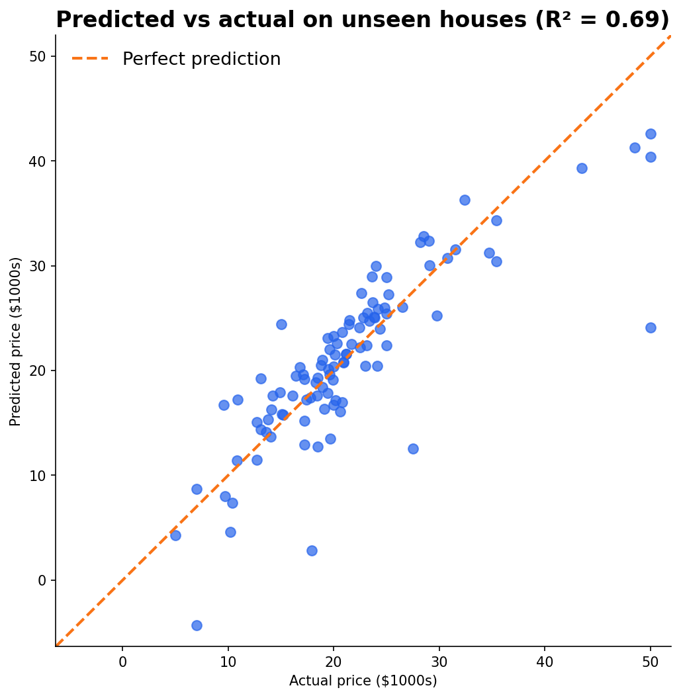
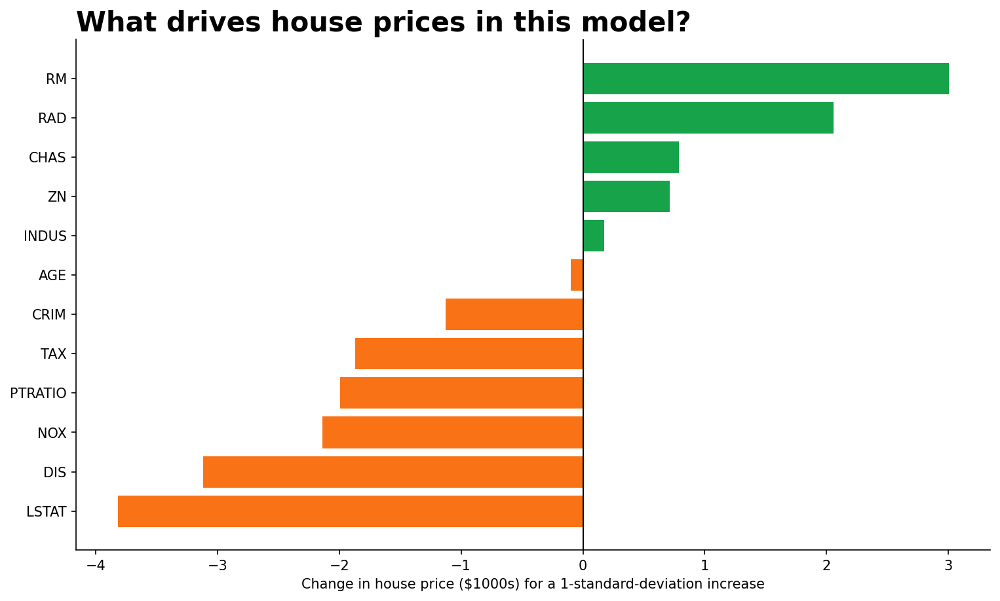

# codveda-ml-task2-linear-regression
Built a linear regression model to predict a continuous variable (e.g., house prices)

# Linear Regression: Predicting House Prices

Codveda Technology Machine Learning Internship · Level 1, Task 2

A reproducible pipeline that trains a linear regression model on housing data,
interprets what it learned, and evaluates it on unseen houses.

## Dataset

506 houses, 13 features, and one target (`MEDV`, median house value in $1000s).
The raw file has no header row, so column names are assigned in code. There are
no missing values or duplicate rows.

## Pipeline

| Step | Script | What it does |
|------|--------|--------------|
| 1 | `01_load_and_preprocess.py` | Loads data, names columns, splits 80/20, standardizes features |
| 2 | `02_train_model.py` | Trains linear regression with scikit-learn |
| 3 | `03_interpret_coefficients.py` | Ranks and explains the coefficients |
| 4 | `04_evaluate_model.py` | Evaluates with R-squared and MSE on unseen houses |

## Key decisions

- **Dropped the `B` column.** It is derived from the racial makeup of a
  neighbourhood, which is why scikit-learn removed this dataset from its library.
  It can be restored by editing `DROP_COLS` in step 1.
- **Price cap.** 16 houses sit exactly at the maximum price ($50k), so their
  true value was cut off. They are kept, and this limitation is noted below.
- **Random split.** The data has no time order, so a random 80/20 split is used
  (404 train / 102 test, `random_state=42`).
- **Two models, same predictions.** One is trained on raw units (easy to
  explain, such as "per extra room") and one on standardized features
  (coefficients comparable across features). Scaling is fitted on training data
  only.

## Results

| | R-squared | MSE | RMSE | MAE |
|---|---|---|---|---|
| Train | 0.740 | 22.60 | 4.75 | 3.42 |
| Test | 0.689 | 22.78 | 4.77 | 3.11 |

- The model explains about 69% of price variation on unseen houses.
- A typical prediction misses by about $4,770 (RMSE; prices are in the
  dataset's original 1970s values).
- Always guessing the average price gives a test MSE of 75.05, so the model
  cuts the error by 70%.
- Train and test scores are close, so there is no heavy overfitting.





## What the model learned

Strongest drivers (effect of a 1-standard-deviation increase, others fixed):

- **LSTAT** (% lower-status population): lowers price the most
- **DIS** (distance to employment centres): farther means cheaper
- **RM** (average rooms): each extra room adds about $4,240
- AGE and INDUS have almost no effect





## Limitations

- Correlated features (for example RAD and TAX are 91% correlated) make some
  individual coefficients unreliable.
- Coefficients show association, not cause.
- The most expensive houses are underpredicted, and one prediction is negative,
  because a linear model cannot keep prices positive.
- With only 102 test houses, the score depends on the random split.
  Cross-validation would give a steadier estimate.

## Setup and run

```bash
pip install -r requirements.txt
python run_all.py
```

The full pipeline takes under 10 seconds. Generated files go to
`data/processed/` and `artifacts/` (not tracked in Git); the coefficient table
and metrics go to `outputs/`.

To run a single step: `python src/04_evaluate_model.py`
(run from the repository root).

### Run in Google Colab

```python
!git clone https://github.com/nikwesamkelo-max/codveda-ml-task2-linear-regression.git
%cd codveda-ml-task2-linear-regression
!pip install -r requirements.txt
!python run_all.py
```

## Tools

Python, pandas, scikit-learn, matplotlib, joblib

## Author

Samkelo · [GitHub](https://github.com/nikwesamkelo-max) ·
[LinkedIn](https://linkedin.com/in/samkelo-nikwe-93226b344)
